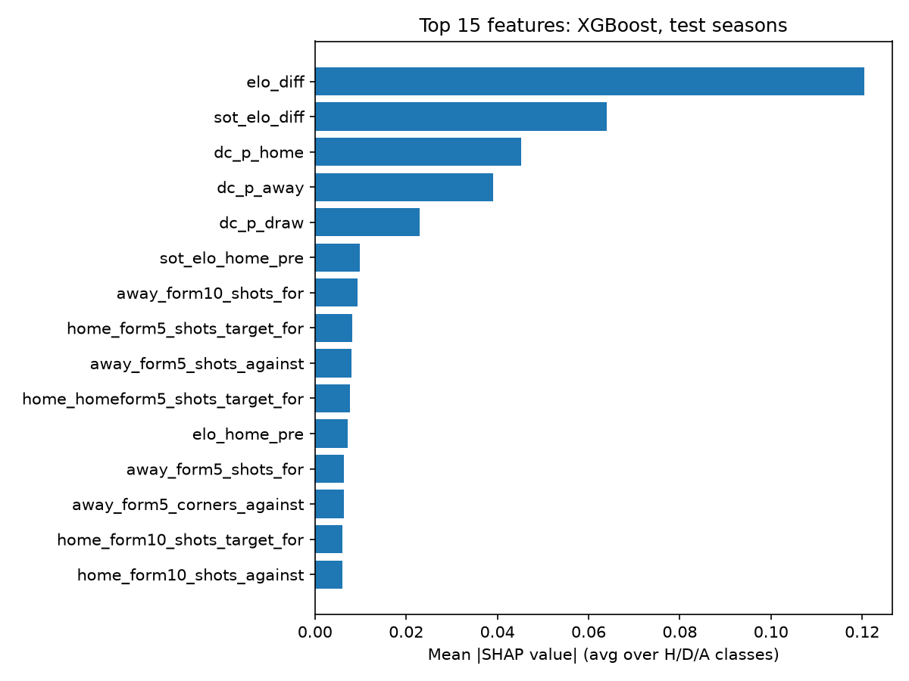
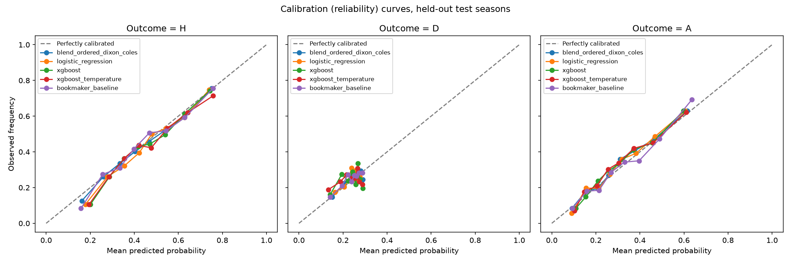

# Premier League Match Outcome Predictor

[](https://github.com/huzaifaguru/premier-league-match-predictor/actions/workflows/ci.yml)

> **TL;DR.** Models from logistic and ordered regression to XGBoost and a time-decayed Dixon-Coles goals model, trained on 26 seasons and tuned by walk-forward CV, then tested once on 1,140 held-out matches (2023/24 to 2025/26).
> The benchmark is the bookmakers' own forecast (the probabilities implied by Bet365's prices, with the profit margin removed). The best model reaches log loss 0.976 against the bookmaker's 0.966, a statistically clear gap (95% CI of the difference: +0.002 to +0.018), so **no model is as accurate as the professional forecast**.
> Team strength carries almost all of the signal: an Elo-only model is within 0.006 log loss of the full 65-input model, and the difference is not significant.

**[Live app](https://premier-league-match-predictor-b.streamlit.app/)** · **[Results](#results)** · **[Limitations](#limitations)** · **[What I'd do next](#what-id-do-next)**

## Problem Statement

Given two Premier League teams and a match date, predict the probability
of a home win, draw, or away win using only information available before
kickoff. The interesting part of this problem isn't fitting a classifier.
It's that bookmakers already publish a very strong forecast for every
match, built by professional analysts with access to team news. So the
real question is whether feature engineering + ML can match that forecast
from public match data alone, and if not, why not. This project treats
"no" as a fully acceptable, reportable answer. It is a forecasting and
evaluation study, not a betting tool.

## Method

**Data.** 9,880 Premier League matches, 26 seasons (2000/01 to 2025/26),
downloaded from [football-data.co.uk](https://www.football-data.co.uk/)
and cached locally (`src/data.py`). Includes goals, shots, shots on
target, corners, and Bet365 prices, which are used only to build the
benchmark. A bookmaker's price converts to a probability (1 / price);
dividing by the total across home/draw/away removes the bookmaker's profit
margin and leaves its forecast. Two versions of that forecast are used:

- **Days before kickoff** (`B365H/D/A`). Per football-data.co.uk's own
  notes these prices are collected on Friday afternoon for weekend matches
  and Tuesday afternoon for midweek ones. This is the main benchmark.
- **At kickoff** (the closing prices, `B365CH/CD/CA`), published only from
  2019/20, so available for all three test seasons. A second, stronger
  benchmark, since it includes late team news.

Two of the older files (2003/04, 2004/05) are malformed (stray empty
trailing columns, non-UTF-8 bytes). The loader trims the empty fields but
checks every row first and refuses to drop any field that holds data.

**Features, 65 inputs, all leakage-safe.** A single forward pass through
matches in date order (`src/features.py`) builds each match's features only
from information strictly before it:
- Rolling form over each team's last 5 and 10 matches (goals for/against,
  shots, shots on target, corners).
- Home-specific and away-specific form (a team's last 5 home matches vs.
  its last 5 away matches).
- Rest days since each team's previous match.
- An Elo rating per team, updated after every match, partly reverted to
  the mean at each season boundary to approximate summer squad turnover.
  K-factor, home advantage and carryover are tuned (see below).
- A **shots-on-target rating**: a second Elo-style rating whose "result"
  is each side's share of the match's shots on target. Shot share is a
  steadier read of how well a team plays than the scoreline.
- **Goals-model inputs**: the Dixon-Coles home/draw/away probabilities,
  refitted every calendar month on the previous four years of matches only
  (`train.add_dc_features`).
- The bookmaker forecast is computed alongside but **excluded** from the
  model's inputs. If the model could see it, comparing the two would be
  meaningless.

Leakage safety is tested, not just asserted. The tests change a future
match's result and check that features for every earlier match are
byte-for-byte unchanged (and that later matches *do* change, so the test
can't pass vacuously), check that appending a later season leaves earlier
features unchanged, and check that the monthly goals-model inputs never
see a result from their own month or later. The suite has 23 tests and
runs in CI.

**Validation.** Never a random split. Two layers, both time-based:
1. *Tuning and model selection*: walk-forward (expanding-window,
   season-by-season) cross-validation on the 23 seasons before the test
   period, validating on each of 2014/15 to 2022/23 (9 folds). Everything
   tunable goes through it: Elo parameters, regression strength, XGBoost
   depth/learning rate/trees, the Dixon-Coles time decay, blend weights,
   and the choice between calibration methods. The **primary model is the
   one with the lowest CV log loss, named before the test seasons are
   scored.**
2. *Final evaluation*: genuine walk-forward on the 3 held-out seasons
   (2023/24 to 2025/26). To predict 2023/24, train on everything before
   it; to predict 2024/25, retrain including 2023/24; and so on.

**Models.**
- Majority-class baseline (always predict a home win).
- Bookmaker forecast: Bet365's probabilities with the margin removed, days before kickoff and at kickoff.
- Multinomial logistic regression.
- **Ordered logistic regression**, which treats away win < draw < home win
  as ordered: one home-versus-away strength score per match and two
  cutpoints, so a draw is most likely when the teams are evenly matched.
- XGBoost.
- [Dixon-Coles (1997)](https://en.wikipedia.org/wiki/Dixon%E2%80%93Coles_model)
  Poisson goals model, with the paper's exponential time-decay weighting
  (tuned; a half-life of about 23 months won).
- Linear blends of each regression model with Dixon-Coles (weights tuned).
- Temperature, multinomial (matrix/Platt-style) and isotonic calibration
  on top of logistic regression and XGBoost, each fitted on out-of-fold
  predictions from the training window only.

**Uncertainty.** Every model is scored on the same 1,140 matches, so
differences are tested with a *paired* bootstrap over matches (5,000
resamples). A block bootstrap over calendar weeks gives the same
conclusions (both are in `reports/evaluation_report.md`). Resampling whole
seasons isn't meaningful with only three test seasons.

## Results

Held out from every stage of tuning and model selection: 2023/24 to
2025/26, 1,140 matches. RPS is the ranked probability score, which treats
home/draw/away as ordered. Lower is better for log loss, Brier and RPS.

| Model | CV log loss | Accuracy | Log loss [95% CI] | Brier | RPS | Δ log loss vs bookmaker [95% CI] |
|---|---|---|---|---|---|---|
| Bookmaker forecast, at kickoff | n/a | 0.550 | 0.960 [0.933, 0.988] | 0.570 | 0.194 | -0.006 [-0.010, -0.002] |
| **Bookmaker forecast, days before** | 0.959 | 0.542 | **0.966** [0.939, 0.994] | 0.574 | 0.196 | (reference) |
| Ordered logit | 0.971 | 0.528 | 0.976 [0.948, 1.004] | 0.582 | 0.199 | +0.010 [+0.002, +0.018] |
| Ordered logit + Dixon-Coles blend (primary, chosen by CV) | **0.970** | 0.530 | 0.977 [0.950, 1.005] | 0.582 | 0.200 | +0.011 [+0.003, +0.018] |
| Logistic regression | 0.972 | 0.531 | 0.978 [0.951, 1.005] | 0.583 | 0.200 | +0.012 [+0.004, +0.020] |
| Logistic regression + Dixon-Coles blend | 0.971 | 0.529 | 0.980 [0.953, 1.007] | 0.584 | 0.200 | +0.014 [+0.007, +0.022] |
| XGBoost | 0.974 | 0.529 | 0.988 [0.961, 1.015] | 0.588 | 0.202 | +0.022 [+0.014, +0.030] |
| Dixon-Coles, time-decayed | 0.987 | 0.498 | 1.006 [0.981, 1.031] | 0.602 | 0.209 | +0.040 [+0.027, +0.053] |
| Dixon-Coles, no decay | 1.001 | 0.495 | 1.029 [1.001, 1.056] | 0.614 | 0.216 | +0.062 [+0.045, +0.081] |
| Always predict home win | n/a | 0.432 | not meaningful* | 1.137 | 0.446 | n/a |

\* *A degenerate 100/0/0 prediction scores the numerical floor on every
non-home-win match; accuracy is the fair number for this baseline.*

**No model is as accurate as the bookmaker forecast.** Every model's log
loss, Brier and RPS difference from it has a 95% CI entirely above zero,
and the at-kickoff forecast is better still. Among the models:

- **The top three regression models are statistically tied on test.** The
  primary blend, the ordered logit and plain logistic regression are all
  within 0.002 of each other, and none of those differences is
  significant. The blend had the best CV score, so it was named the
  primary model in advance and is what the app serves.
- **Logistic regression beats XGBoost**, by 0.010 log loss (CI [0.004,
  0.016]). With most of the signal in a few smooth team-strength ratings,
  the trees' extra flexibility mostly fits noise.
- **Time decay matters for Dixon-Coles:** 1.029 without it, 1.006 with it.

Full tables (all calibration variants, Brier/RPS CIs, every pairwise
comparison, block bootstrap) are in
[`reports/evaluation_report.md`](reports/evaluation_report.md).

**What improved the model.** A second round of experiments tried five
ideas, each scored only by CV on the tuning seasons (the paired 95% CI is
of the change in CV log loss for logistic regression):

| Idea | Change in CV log loss [95% CI] | Adopted |
|---|---|---|
| Ten more seasons of training data (2000/01 to 2009/10) | -0.0062 [-0.0103, -0.0026] | yes |
| Goals-model (Dixon-Coles) probabilities as inputs | -0.0042 [-0.0059, -0.0024] | yes |
| Ordered instead of multinomial regression | -0.0039 [-0.0068, -0.0009] | yes |
| Shots-on-target rating | -0.0027 [-0.0043, -0.0010] | yes |
| Elo that counts the margin of victory | -0.0011 [-0.0018, -0.0003] | no (no gain once combined with the rest) |

These overlap, because they all measure team strength, so together they
gave about -0.005 in CV rather than the sum. On the held-out test seasons
the new primary model improves on the previous one (a logistic regression
+ Dixon-Coles blend on 16 seasons and 59 features) by about the same
amount the CV predicted:

| Test seasons | Previous model | New model | Change [95% CI] |
|---|---|---|---|
| Log loss | 0.982 | 0.977 | -0.005 [-0.010, -0.000] |
| RPS | 0.201 | 0.200 | -0.001 [-0.002, -0.000] |
| Accuracy | 52.7% | 53.0% | +0.3 pts [-0.7, +1.2], not significant |

The gap to the bookmaker shrank from 0.016 to 0.011 but did not close.

**Tried and not adopted.** Two richer measures of team quality were
tested the same way (CV on the tuning seasons only) and left out because
they added almost nothing on top of the existing ratings:

- **Expected goals (xG)** from Understat (2014/15 onward), as a rating
  and as rolling averages: about -0.001 CV log loss, 95% CI [-0.002,
  +0.000]. Too small to justify the live app depending on scraping a site
  with no official API.
- **Squad market values** from the CC0
  [transfermarkt-datasets](https://github.com/dcaribou/transfermarkt-datasets)
  project, taken strictly before each match: -0.0003 [-0.0009, +0.0003]
  overall, and no clear gain even for promoted teams (-0.0006 [-0.0020,
  +0.0008]) or the first weeks of a season, where it was expected to help
  most.
- **Weighting recent seasons more heavily** in training: worse at every
  strength tried (+0.0001 to +0.0037), so all 26 seasons count equally.
- **A stacking meta-model** learning how to combine the ordered logit,
  logistic regression, XGBoost and Dixon-Coles from out-of-fold
  predictions: worse (+0.004 to +0.007); the simple tuned blend wins.
- **Other form-window lengths** (3/8, 4/12, 6/15, 10/20 instead of 5/10):
  the best, 3/8, was -0.0005 [-0.0018, +0.0008], better in only 5 of 9
  folds, which is noise.

- **Player availability**: the share of a team's regulars (by FPL price,
  from the MIT-licensed
  [vaastav FPL archive](https://github.com/vaastav/Fantasy-Premier-League))
  who did not play, a stand-in for injuries, suspensions and rotation:
  -0.0007 [-0.0020, +0.0005]. Clean starting-lineup data only exists from
  2022/23, which is essentially the test period, so this used a proxy
  that can only overstate the gain; even so it is not significant.

The model's results Elo, shots-on-target rating and goals model already
track team quality closely. The bookmaker's edge is mostly not lineups
either: its forecast days before kickoff (before lineups are announced)
already beats every model by 0.011, while knowing the lineups (its
at-kickoff forecast) adds only another 0.006. The remaining gap is more
likely earlier injury news, expert judgment and the betting market
pooling information.

**Why the professionals still win: team strength carries almost all the
signal.** A feature ablation, with each feature set's hyperparameters
tuned separately by CV:

| Features | Logistic regression log loss | XGBoost log loss |
|---|---|---|
| Elo only (3 features) | 0.984 | 0.990 |
| Elo + overall rolling form (39) | 0.980 | 0.986 |
| All 65 inputs | 0.978 | 0.988 |

Going from Elo only to all 65 inputs improves logistic regression by
0.006 (CI [-0.002, +0.014]) and XGBoost by 0.002 (CI [-0.005, +0.010]),
and neither is significant. SHAP on XGBoost tells the same story from another angle: the top
five features are all team-strength ratings (the Elo gap, the
shots-on-target rating gap, and the three goals-model probabilities).
The ablation is the stronger evidence, because SHAP splits credit across
correlated ratings in ways that are hard to interpret.



The bookmakers' forecast already accounts for team strength, plus
injuries, lineups and news that aren't in this dataset. A model built from
a strict subset of what they know has a low ceiling by construction.

**Draws are never the top pick.** The primary model's confusion matrix on
the test seasons:

|  | Predicted H | Predicted D | Predicted A |
|---|---|---|---|
| **Actual H** | 403 | 0 | 89 |
| **Actual D** | 171 | 0 | 108 |
| **Actual A** | 168 | 0 | 201 |

It never predicts a draw as the most likely outcome, out of 279 actual
draws. This is expected: a draw is rarely the single most likely outcome
of a match (it usually sits around 25 to 30%), so an argmax classifier
almost never picks it. The draw probabilities themselves are reasonably
calibrated (middle panel below), which is why the app shows the full
home/draw/away split instead of only the pick.

**Calibration: no method helped.** Reliability curves on the test seasons:



The uncalibrated models already track the diagonal about as well as the
bookmaker. Calibrators were fitted only on out-of-fold predictions from
each training window, and each is compared with its own base model
(log loss difference, paired 95% CI):

| Method | On logistic regression | On XGBoost |
|---|---|---|
| Temperature scaling | +0.002 [-0.000, +0.004] | +0.002 [-0.000, +0.004] |
| Multinomial (matrix) scaling | -0.001 [-0.005, +0.004] | -0.003 [-0.008, +0.001] |
| Isotonic | +0.037 [+0.002, +0.100] | +0.002 [-0.005, +0.009] |

CV on the tuning seasons ranked every calibrated variant below its base
model, so none were adopted, and on test none is significantly better.
Isotonic regression can be actively harmful, and the mechanism is visible
in the predictions: its step function can assign *exactly zero*
probability to an outcome that then happens (1 test match for logistic
regression in this run), and each such match costs about 36 nats of log
loss.

**A note on apparent "edges".** When the model and the bookmaker
disagree, it is tempting to read that as the model spotting value. It
isn't. The model's probabilities differ from the bookmaker's by random
noise, and whenever you pick the largest of three noisy differences, one
almost always looks favourable (the "winner's curse"). A simulation with
pure noise of the same size reproduces the effect, and a paper-money
stress test of acting on those differences lost steadily. The details,
kept as a technical diagnostic, are in
[`reports/evaluation_report.md`](reports/evaluation_report.md). This
project is not a betting tool, and nothing in it is betting advice.

## Limitations

- **No lineup, injury, or news information.** This is the single largest
  gap vs. the bookmaker, whose at-kickoff forecast includes exactly this.
- **Only three test seasons.** Confidence intervals are about ±0.03 on log
  loss for a single model. Paired differences are much tighter, but
  season-level effects (one unusual season) can't be separated from
  model quality.
- **Cold start for promoted teams.** The ratings start at league average,
  and Dixon-Coles uses average attack/defense, for teams with no Premier
  League history in the window.
- **Elo tuning barely matters.** The original defaults (K=20, home
  advantage 60, carryover 0.75) score only 0.0008 worse in CV than the
  tuned best, and for any K from 15 to 30 and any home advantage, the
  best carryover gets within 0.0006. Rolling-window lengths (5/10
  matches) are still untuned.
- **Every choice was made on the same CV folds that score it** (the
  hyperparameters, the blend weights, and which of the second-round ideas
  to adopt), so CV numbers are slightly optimistic. The test seasons were
  never used for any of it, which is why the test results are the ones
  reported above.

## What I'd Do Next

Done so far: RPS, bootstrap confidence intervals, a time-decayed
Dixon-Coles tuned in the CV loop, blends, tuned Elo, a feature ablation,
alternative calibration methods, and a round of model improvements (more
history, a shots-on-target rating, goals-model inputs, ordered
regression).

1. **Add news/lineup features** (confirmed starting XI, key injuries). The
   most likely way to close some of the gap to the bookmaker.
2. **A proper stacking model**: learn the blend on out-of-fold
   predictions with a meta-model, rather than a single linear weight.
3. **A second bookmaker's forecast** (Pinnacle, available from
   2012/13), widely regarded as the most accurate bookmaker forecast.
4. **Bayesian team ratings** (e.g. a hierarchical Dixon-Coles), giving
   each prediction an honest uncertainty band.
5. **Tune the rolling-window lengths**, the last untuned feature choice.

## Repo Structure

```
.github/workflows/  CI: installs requirements and runs pytest on every push/PR to main
.streamlit/         Streamlit theme config
assets/crests/      team crest images used by the app (see its README)
src/
  config.py         paths, seasons, Elo and shots-on-target rating settings
  data.py           download + cache raw CSVs from football-data.co.uk
  features.py       leakage-safe rolling form, Elo, shots-on-target rating, rest days (LeagueState)
  train.py          all models, goals-model inputs, calibration, walk-forward tuning and CV model selection
  evaluate.py       test-season evaluation: bootstrap CIs, ablation, calibration, SHAP, "edge" diagnostic
  app_model.py      builds/loads the small model artifact the app serves
  app_helpers.py    app data helpers (recent form, standings, head-to-head); not model features
  ui.py             app presentation: colour tokens, the one CSS function, HTML components
tests/              leakage guards and model/metric tests (pytest, run in CI)
app.py              Streamlit app
models/             best_params.json, tuning/CV tables, app_model.joblib (5 KB)
reports/            generated plots and tables, including evaluation_report.md
data/               raw/ and processed/ caches (gitignored, re-downloadable)
```

## Running Locally

Requires Python 3.12 (the pinned numpy/scipy/xgboost versions have no
3.11 wheels).

```bash
pip install -r requirements.txt
python -m src.data          # download + cache raw CSVs
python -m src.train         # walk-forward tuning + CV model selection (~20 min)
python -m src.evaluate      # held-out evaluation, writes reports/ (~3 min)
python -m src.app_model     # refit and save the app's model artifact
pytest tests/               # leakage guards + model tests
streamlit run app.py        # the app
```
